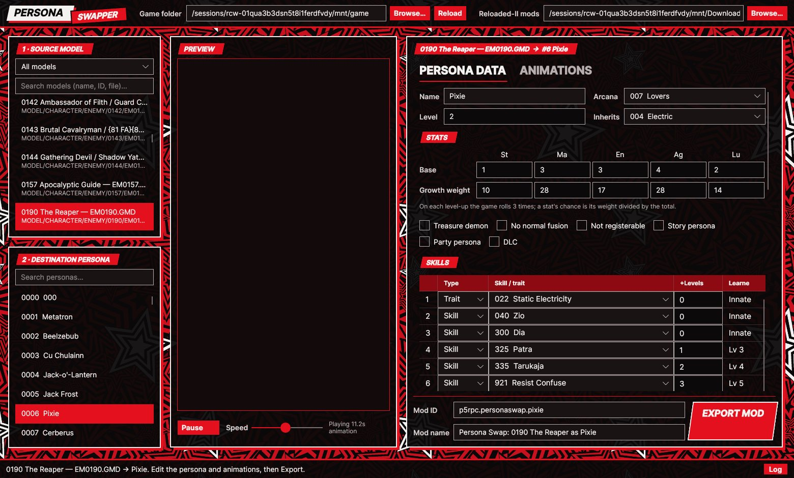

# Persona Swapper

A tool for macOS, Windows and Linux for Persona 5 Royal that turns any model in the game into a persona:

1. **Source model** — any GMD in `BASE.CPK`: Shadows and bosses, other personas, party members, NPCs.
2. **Destination persona** — the persona whose slot the model takes over.
3. **Edit and preview** — persona data (name, arcana, level, stats, growth, flags, 16 skills/traits, 20 affinities,
   battle model scale, compendium lore),
   an animation table (one row per persona animation slot, filled from any GAP in the game), and a live 3D preview
   of the selected slot playing on the source model.
4. **Export** — writes a Reloaded-II mod (Persona Essentials) with the model, rebuilt animation packs and any edited tables.



## Run it

Download a build from the [Releases](https://github.com/RaihoHeeHo/PersonaSwapper/releases) page, or build from source.

Requirements for building: the .NET 8 SDK (`brew install --cask dotnet-sdk`), and the GFD-Studio macOS port
(`git clone -b macos-port https://github.com/RaihoHeeHo/GFD-Studio GFD-Studio-macOS`) in the folder next to this one.

Double-click **Run Persona Swapper.command**, or from Terminal:

```sh
cd ~/Downloads/p5r-build/src/PersonaSwapper
dotnet run -c Release --project PersonaSwapper.App
```

### Standalone apps

Double-click **Build Release.command** to build apps that run without .NET installed (internet needed the first time):

| Output in `release/` | For |
|---|---|
| `macOS-Apple-Silicon/Persona Swapper.app` | M1–M4 Macs |
| `macOS-Intel/Persona Swapper.app` | Intel Macs |
| `Windows/PersonaSwapper.exe` | 64-bit Windows (single file) |

On Linux, run `./build-linux.sh` (x64 or arm64, matching the machine) for a `.tar.gz` and, if `appimagetool` is installed,
an AppImage. Releases include both for x64 and arm64. From the `.tar.gz`, run `PersonaSwapper` directly or
`install-desktop-entry.sh` to add it to your applications menu.

plus a `.zip` of each for sharing. The Mac apps are signed ad hoc and not notarized: they open normally on the Mac
that built them, but on another Mac the first launch needs right-click → Open (or System Settings → Privacy & Security
→ Open Anyway). Windows SmartScreen may show "Windows protected your PC" for the unsigned exe; choose More info → Run anyway.

The game folder defaults to `~/Library/Application Support/Steam/steamapps/common/P5R`, and exports go to
`Reloaded-II/Mods` inside it. Both can be changed at the top of the window.

## How the swap works

| Game files | What the tool writes |
|---|---|
| `MODEL/CHARACTER/PERSONA/<id>/PS<id>.GMD` (and `PSZ`/`PSZX` compendium models) | the source model |
| `BPS<id>_000.GAP` (battle animations, 11 slots) and `GT<id>.GAP` | the persona's own pack with each slot replaced as chosen |
| `MODEL/CHARACTER/ENEMY/<shadow>/EM<shadow>.GMD` (+ `BEM…_000.GAP` for Shadow sources) | the source model: the persona menu and compendium show the persona's **Shadow** model (optional; the Shadow changes in battle too) |
| `BATTLE/TABLE/PERSONA.TBL`, `UNIT.TBL`, `NAME.TBL`, `VISUAL.TBL` | only if edited; Persona Essentials merges them with other mods |
| `FACILITY/DATMYTH.BMD` and its copy `datMyth.bmd` in `INIT/DATMSG.PAK` | only if the lore was edited: the changed entries as `FEmulator/BMD/DATMYTH.msg`, which Persona Essentials merges with other mods' lore (the edited BMD is included as the stand-in the merge replaces) |

Findings this is based on (checked against the game files):
- Persona folders are named by persona ID. All 302 personas use battle slots 0 and 5–10; slots 1–4 are unused.
  Slot 0 is the long idle loop and slot 5 the appearance.
- Personas and Shadows share one slot layout: in the base game, persona slot N is a copy of the matching Shadow's slot N.
  So a Shadow or persona source uses its own animations slot-for-slot with no retargeting.
- Every slot defaults to the source model's own animations ("own" packs in the table): a Shadow's `BEM` packs, a persona's
  `BPS`/`GT`, or a character's `BATTLE`/`FIELD`/`EVENT`/`LIFE` subfolder packs plus `COMMON_ANIM/BCMN<id>`/`ACMN<id>`
  (battle packs for the model's costume first, e.g. Joker's `BB0001_051.GAP` with 90 battle animations). The destination
  persona's packs are still offered, labelled "(retarget)".
- The "Shadows / bosses" list leaves out the 148 Shadows that are just a persona's Shadow form (same textures as the
  persona's own model, which is under "Personas"); they're still under "All models". Bosses name a persona in UNIT.TBL
  too (Kamoshida names Arsène), so the list comes from texture matching (`pswap <game> shadowmap`).
- The "Bones" column shows how many of an animation's bones exist on the source model; low numbers mean that motion
  won't play properly on it.
- The game matches animation controllers to bones by name: shipped packs have indices that don't line up with
  their models and controllers for bones no model has (`RootNode`, `lookat`). So the tool leaves animations as shipped
  and only re-points indices for animations taken from another model. With the source's own animations (and in an
  "identity" swap of a persona onto itself) the exported packs are byte-for-byte the game's.
- Bone names are UTF-8 (e.g. `Bip01 L ﾎﾟﾆｰﾃｰﾙ 1`), each stored with a hash. GFDLibrary used to read them as Shift-JIS,
  which garbled such names and their hashes on save; names now pass through byte-exact with their original hashes.
  `pswap <game> gaproundtrip` re-saves all 400 persona packs identically.
- Preview navigation: drag to rotate, right-drag or Shift-drag to pan, scroll or pinch to zoom, double-click or **Fit**
  to frame the whole animation, **Reset** (R) for the default view. **Follow** (on by default) keeps the camera on the
  model, since battle animations can carry a model up to ~30× its own size away (e.g. Joker running across the field).
  Framing ignores the outermost 1% of vertices so stray parts don't shrink the model.
- Preview materials follow the game's settings: P5R stores other data in the diffuse alpha of most opaque materials
  (310 of 351 sampled), so alpha is only used for alpha-tested, transparent or additive materials.

## New personas (free slots)

Tick **Free slots: add as a new persona** above the destination list to pick one of the game's unused persona slots
instead of replacing a persona. Of the 464 persona IDs, 302 have models; 101 of the rest are safe placeholders
("RESERVE", "P5 Unused") that no real Shadow recruits and that aren't party or story personas. Their table rows
(stats, skills, lore, scale) already exist but are flagged *Not registerable*.

Exporting to a free slot writes a new `PERSONA/<id>/` folder (model, battle and menu packs, built from Pixie's pack
layout), clears *Not registerable*, gives the slot a level, name and 100% scale, and saves its stats, skills, lore etc.

**Custom Bonus Tweaks Installed** (checkbox in the top bar, remembered): for players using the Custom Bonus Tweaks mod,
which makes the game load `PSZ<id>.GMD` instead of the enemy model in menus. In this mode no export writes or replaces
an enemy model (`EM`/`BEM`), only the persona files and `PSZ`, and 16 more slots become available: persona IDs 221–238
that have no persona model but share their number with a boss model (unused story copies of the party's personas;
untested, their story/party flags are cleared when used).

**Recruit from a Shadow** (works for any persona) points one Shadow's negotiation at this persona in `UNIT.TBL`.
The Shadow keeps its own look.

Menus, the compendium and the fusion screen load `ENEMY/<persona id>/EM<persona id>.GMD` (the Shadow model, looked up
by the persona's own ID; with it missing, the game retries it and shows no model). Free slots are only offered when the
game has no `ENEMY/<id>` folder, and exports write the new model there (plus the source's own Shadow animations when
the source is a Shadow). Personas also have `PSZ<id>.GMD` (80 of the 103 personas
without a Shadow ship one, a copy of PS). New personas didn't have one and viewing them in the compendium crashed, so
every export writes `PSZ<id>.GMD` (a copy of the new model), which some other mods also expect.
Confirmed in game: a new persona appears in the compendium, shows its model, and can be fused normally by arcana and level.

`BATTLE/TABLE/EXIST.TBL` lists every persona that exists (section 4 of four: sorted `{persona id, flags}` pairs, the
last ID repeated as an end marker; the header holds each section's count and offset). It contains all 264 compendium
personas but only 23 of the free slots. Exports add the new persona, and every other free slot so new-persona mods
can be combined.

`INIT/SHDPERSONA.PDD` (465 × 76-byte records, record = persona ID) has a float 48 bytes into each record that is 1.0
for all 264 compendium personas and 0.0 for the 130 unused slots. The community Alraune mod (slot 351) sets exactly
that value; exports now set it to 1.0 for the new persona and every other free slot.

The Velvet Room places each persona's model using `FACILITY/COMBINE/TABLE/FCLCMBMODELPOS.DAT` (465 × 48-byte entries,
entry `id + 1` = persona `id`: position, scale, rotation). Every compendium persona has an entry; free slots are all
zeros, and the fusion screen and compendium crashed with a new persona in the game. Exports to a free slot copy the
placement of the persona closest in size (or the source itself if it is a persona), and give every other free slot a
typical placement so several new-persona mods can be combined.

## Projects

- `PersonaSwapper.Core` — CPK reading (CriFsV2Lib), table parsers, model catalog, swap builder, mod writer, pose/skinning.
- `PersonaSwapper.App` — the Avalonia GUI and OpenGL preview.
- `PersonaSwapper.Cli` (`pswap`) — test harness: catalog, persona dumps, table round-trips, slot statistics, swaps, PNG renders.
- `PersonaSwapper.Snapshot` — runs the GUI headlessly and saves screenshots.

Lore and scale details:
- Lore is one single-page message per persona (`myth_<id>`). The editor keeps the page's leading control codes,
  wraps text at 22 characters (99% of the game's lines are 22 or shorter) and warns past 10 lines (the game's longest entries).
- Battle model scale is `VISUAL.TBL` segment 2, byte 96 of each persona's 148-byte entry (100% for 295 of 464 personas).
  "Match original size" sets `original scale × destination model height ÷ source model height`, so the new model
  stands as tall in battle as the persona it replaces.

## Troubleshooting

The app writes a log to `~/Library/Logs/PersonaSwapper/persona-swapper.log` (the **Log** button in the status bar
opens the folder; the previous run is kept as `persona-swapper.previous.log`). Each line is written to disk immediately:
- `STEP` lines mark work about to happen (parsing a model, uploading mesh N, first frame). If the app dies outright,
  the last `STEP` shows where.
- `CRASH` blocks hold the full exception and stack trace for anything unhandled; the app keeps running when it can.
- `WARN` lines flag bad model data that was worked around (out-of-range triangles, NaN vertices, undecodable
  textures) and OpenGL errors.
- The OpenGL driver, version and renderer are logged when the preview starts.

`pswap <game-folder> previewcheck <start> <count> [filter]` runs the preview's loading, skinning, animation and texture
code over many models outside the GUI. Across all 2,194 models: no failures; 14 models have a few NaN vertices
(hidden in the preview) and one texture can't be decoded (drawn untextured).

## Not done yet

- Bone-name mapping for retargeting between different skeletons.

## License

Persona Swapper is released under the GNU General Public License v3.0 (see `LICENSE`).
It is a fan-made tool, not affiliated with Atlus or SEGA, and contains no game files: it reads your own copy of the game.

## Credits

Table layouts from the 010 Editor templates by TGE, Scarltz, Lipsum, DeathChaos and Sierra; GFDLibrary by TGE;
CriFsV2Lib by Sewer56 (LGPL-3.0).
